# Baraja Española para Nintendo 3DS

Juegos de cartas con la baraja española de 40 cartas, hechos como homebrew
para Nintendo 3DS con [devkitPro](https://devkitpro.org) (libctru + citro2d).

| Menú | Siete y media | Resultado | Cinquillo |
|:---:|:---:|:---:|:---:|
| 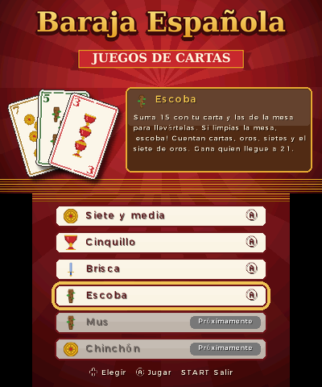 | 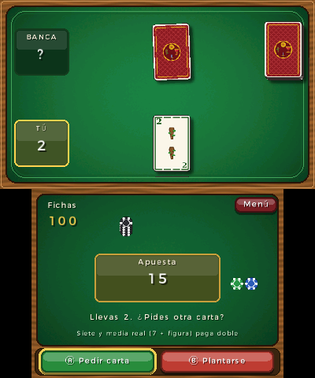 | 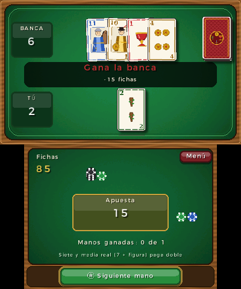 | 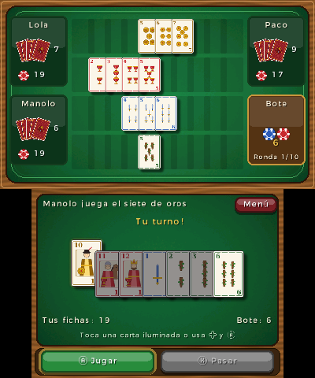 |

| Brisca | Escoba | Fin de ronda de la escoba |
|:---:|:---:|:---:|
| 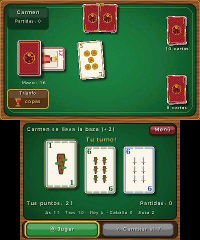 | 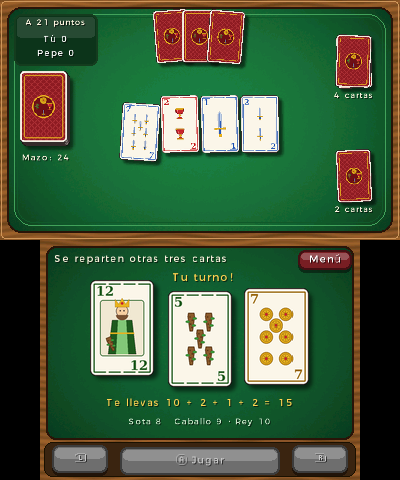 | 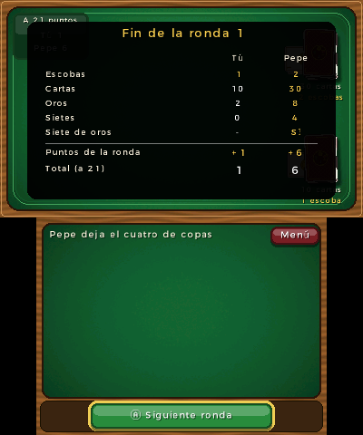 |

| Chinchón | Cierre del chinchón | Mus | Recuento del mus |
|:---:|:---:|:---:|:---:|
| 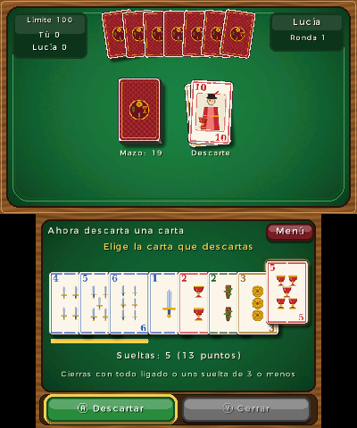 | 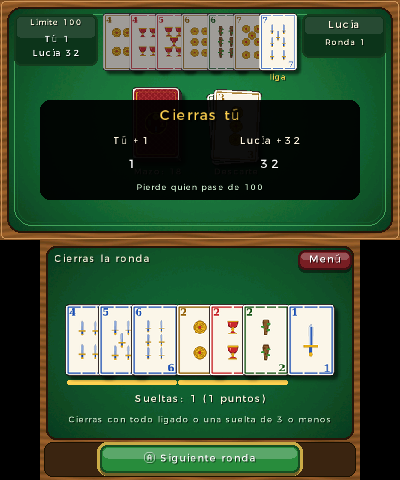 | 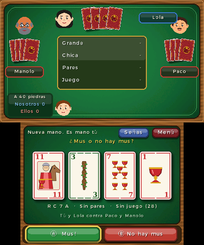 | 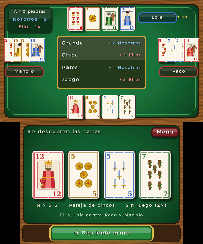 |

| Guiñote | Solitario | Solitario en pirámide | Póker |
|:---:|:---:|:---:|:---:|
| 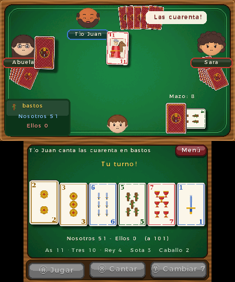 | 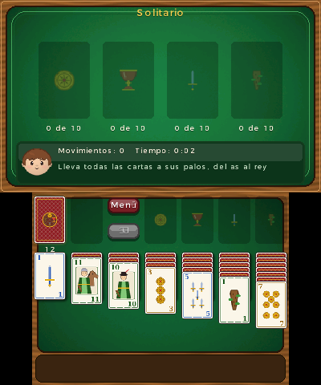 | 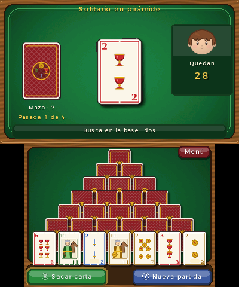 | 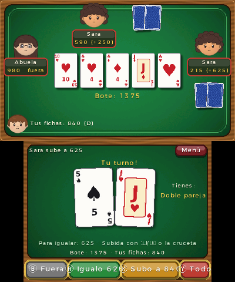 |

| Tu perfil | Tus rivales (Miis de la consola) | Señas del mus | Editor del dorso |
|:---:|:---:|:---:|:---:|
| 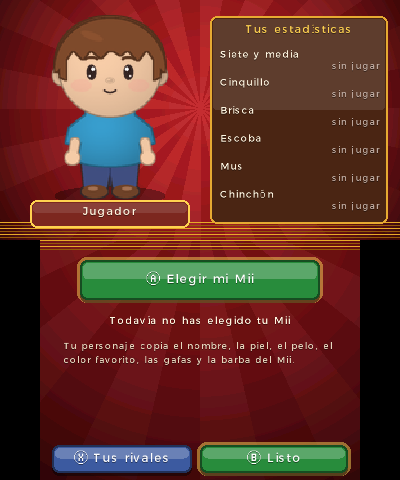 | 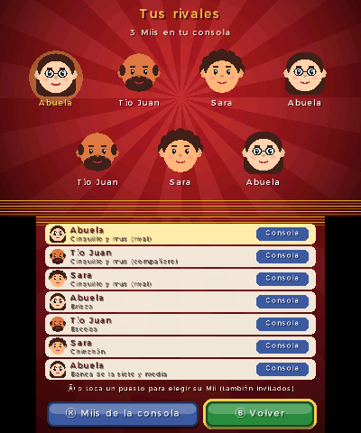 | 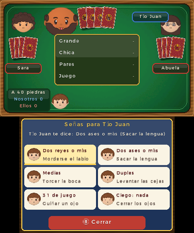 | 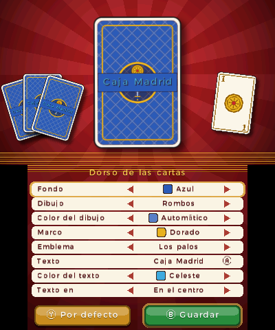 |

## Los personajes: basados en los Miis de tu consola

Cada jugador es un **personaje dibujado al estilo de Animal Crossing** (cabeza
grande y redonda, ojos sencillos y coloretes) que toma su aspecto de un **Mii de
tu consola**: el nombre, el sexo, el color de piel, el color de pelo, un peinado
parecido, el color favorito (la camiseta), las gafas y la barba o el bigote.
No hace falta conexión a internet: todo se dibuja en la consola.

- **Tu personaje**: la primera vez eliges tu Mii con el **selector de Miis del
  sistema** (la pantalla de Nintendo que usan los juegos para elegir un Mii).
  Puedes elegir uno de tus Miis o uno de los **Miis invitados**.
- **Tus rivales**: al arrancar, el juego lee la lista de Miis de la consola (la base
  de datos del editor de Miis, `CFL_DB.dat`, en los datos compartidos del sistema)
  y los reparte entre los puestos de la CPU: la banca de la siete y media, los tres
  de la mesa de cinquillo y mus, y los rivales de brisca, escoba y chinchón. Cada
  rival se llama como su Mii. Tu propio Mii nunca hace de rival.
- En **Mi perfil → Tus rivales** ves quién ocupa cada puesto y puedes cambiar
  cualquiera con el selector de Miis, también por Miis invitados. Con **Miis de la
  consola** vuelves al reparto automático.
- Si la consola no tiene Miis (o no se puede leer la lista), se usan unos
  personajes de reserva hasta que elijas los tuyos o Miis invitados con el selector.

Las piezas de los personajes (cabezas, peinados, ojos, bocas, ropa...) las genera
`tools/gen_characters.py` en gris, y el juego las tiñe con los colores de cada Mii.

El perfil guarda tus estadísticas en `/3ds/JuegosDeCartas/perfil.dat` y los
rivales que elijas a mano en `/3ds/JuegosDeCartas/rivales.dat`.

Los personajes parpadean, se alegran cuando ganan, se entristecen cuando pierden y
se sorprenden con una escoba, un chinchón o un órdago.

## Editor del dorso de las cartas

En **Configuración → Dorso de las cartas** (en el menú) diseñas la parte de atrás de las cartas,
con una vista previa grande en la pantalla de arriba:

- **Fondo**: 14 colores.
- **Dibujo**: liso, rombos, rayas, lunares, cuadros, ondas o estrellas, y su color
  (automático: un tono más claro que el fondo).
- **Marco**: dorado, plateado, blanco, negro o sin marco.
- **Emblema** del centro: los cuatro palos, un oro, una copa, una corona, una
  estrella o ninguno.
- **Texto**: lo escribes con el teclado de la consola (hasta 16 caracteres, por
  ejemplo *Caja Madrid* o el nombre de tu peña), con su color y su posición
  (arriba, en el centro o abajo).

Con la cruceta eliges la opción y la cambias con ◀ ▶ (o tocando las flechas); el
texto se escribe con Ⓐ. **Guardar** lo deja en `/3ds/JuegosDeCartas/dorso.dat` y
se usa en todos los juegos; **Por defecto** recupera el dorso granate de siempre.
El juego compone el dorso en una textura con las capas que genera
`tools/gen_backs.py`.

## Juegos

El menú tiene páginas (se cambian con L/R o tocando las pestañas): **Baraja española**, **Baraja francesa** y **De mesa**. Cada una tiene sus juegos y sus **Próximamente** (los que todavía no se
pueden jugar; la lista se desplaza con la cruceta) y, en pequeño, **Configuración** (*Mi perfil* y *Dorso de las cartas*).


| Juego | Estado |
|---|---|
| Siete y media | ✅ Disponible |
| Cinquillo | ✅ Disponible |
| Brisca | ✅ Disponible |
| Escoba | ✅ Disponible |
| Mus | ✅ Disponible |
| Chinchón | ✅ Disponible |
| Guiñote | ✅ Disponible |
| Solitario tradicional | ✅ Disponible |
| Solitario en pirámide | ✅ Disponible |
| Tute | ✅ Disponible |
| Tute cabrón | ✅ Disponible |
| La mona | ✅ Disponible |
| Cucú | ✅ Disponible |
| Treinta y una | ✅ Disponible |
| Mentiroso | ✅ Disponible |
| Culo | ✅ Disponible |
| Pocha | ✅ Disponible |
| Póker (baraja francesa) | ✅ Disponible |
| Blackjack (baraja francesa) | ✅ Disponible |
| Corazones (baraja francesa) | ✅ Disponible |
| Conecta 4 (juego de mesa) | ✅ Disponible |
| Damas (juego de mesa) | ✅ Disponible |
| Dominó (juego de mesa) | ✅ Disponible |
| Uno (juego de mesa) | ✅ Disponible |
| Rummikub (juego de mesa) | ✅ Disponible |
| Mierda | 🕓 Próximamente |
| Burro | 🕓 Próximamente |
| As, 2, 3 | 🕓 Próximamente |
| Tute subastado | 🕓 Próximamente |
| Julepe | 🕓 Próximamente |
| Tresillo | 🕓 Próximamente |
| Cuatrillo | 🕓 Próximamente |
| Subasta | 🕓 Próximamente |
| Truc | 🕓 Próximamente |
| Truco argentino | 🕓 Próximamente |
| Butifarra | 🕓 Próximamente |
| Pumba | 🕓 Próximamente |

### Siete y media
Te enfrentas a la banca. Las cartas del 1 al 7 valen su número y las figuras
(sota, caballo y rey) medio punto. Pide cartas hasta acercarte a 7½ sin pasarte.
Los empates son para la banca y la **siete y media real** (un 7 y una figura con
solo dos cartas) cobra el doble. Empiezas con 100 fichas y apuestas entre 5 y 50
en cada mano.

La banca no hace trampas: tu primera carta está boca abajo y solo ve las demás.

### Cinquillo
Partida a cuatro jugadores (tú contra tres Miis). Se reparten las 40
cartas; sale quien tenga el cinco de oros. En cada turno hay que colocar una carta
si se puede: un cinco abre un palo nuevo y en los palos abiertos se continúa la
escalera hacia abajo (4, 3, 2, 1) o hacia arriba (6, 7, sota, caballo, rey). Si no
puedes jugar, pasas y pagas una ficha al bote. Quien se queda antes sin cartas
gana la ronda y se lleva el bote. La partida dura 10 rondas o hasta que alguien
se arruine.

### Brisca
Partida a dos contra un Mii. Cada uno tiene tres cartas y la muestra (la carta
que queda boca arriba bajo el mazo) marca el palo de triunfo. No es obligatorio
asistir: gana la baza el triunfo más alto o, si no hay, la carta más alta del palo
que salió. El orden es as, tres, rey, caballo, sota, 7, 6, 5, 4 y 2, y los puntos
son as 11, tres 10, rey 4, caballo 3 y sota 2. Tras cada baza roba primero quien
la gana, y sale en la siguiente. Gana quien pase de 60 de los 120 puntos.

Quien tenga el 7 de triunfo puede cambiarlo por la muestra cuando esta es un as,
un tres o una figura; si la muestra es más baja, se cambia con el 2. El cambio se
hace al salir, mientras quede mazo.

### Escoba
Partida a dos contra un Mii. Las cartas valen su número, salvo sota 8, caballo 9 y
rey 10. Hay cuatro cartas en la mesa y tres en cada mano. Si tu carta suma 15 con
una o varias de la mesa, te las llevas (si puede sumar 15, tiene que llevárselas;
si hay varias combinaciones, eliges cuál). Si no suma 15, la carta se queda en la
mesa. Dejar la mesa vacía es una **escoba**. Cuando se acaban las manos se
reparten otras tres hasta agotar el mazo, y lo que queda en la mesa es del último
que recogió. Si al repartir la mesa suma 15 (o 30), el que reparte hace escoba.

Cada ronda da un punto por escoba, por tener más cartas, más oros, más sietes y
por el siete de oros. Gana la partida quien llegue antes a 21.

### Chinchón
Partida a dos contra un Mii, con siete cartas cada uno. En tu turno robas una carta
(del mazo o la de arriba de los descartes) y descartas otra. Se combinan **tríos o
cuartetos** del mismo número y **escaleras** de tres o más cartas seguidas del
mismo palo (1-7, sota, caballo, rey). Tu mano se ordena sola: las combinaciones
van primero, separadas y subrayadas en dorado, y debajo se ve cuánto suman las
sueltas.

Puedes **cerrar** al descartar si te queda todo combinado o una sola carta suelta
de 3 o menos. Entonces cada uno suma sus cartas sueltas (las figuras valen 10),
pero antes el que no cierra puede **ligar** sus sueltas a las combinaciones del
que cierra. Cerrar con todo combinado resta 10 puntos, y cerrar con siete cartas
seguidas del mismo palo es **chinchón**: partida ganada. Pierde quien pase de 100.
Si se acaba el mazo, se barajan los descartes.

### Mus
Por parejas (tú y un Mii compañero contra dos Miis rivales), a ocho reyes (los treses cuentan como
reyes y los doses como ases). Cada uno tiene cuatro cartas. Primero se pide **mus**:
si los cuatro lo quieren, cada uno cambia las cartas que elija; en cuanto alguien
dice **no hay mus** se juegan los cuatro lances:

- **Grande**: gana la jugada más alta (rey, caballo, sota, 7... as).
- **Chica**: gana la más baja.
- **Pares**: pareja (1 piedra), medias (trío, 2) y duples (dos parejas, 3). Solo se
  envida si las dos parejas tienen pares.
- **Juego**: 31 o más contando las figuras a 10 (31 vale 3 y el resto 2; el orden es
  31, 32, 40, 37, 36, 35, 34, 33). Si nadie tiene juego se juega al **Punto**.

En cada lance se puede pasar, envidar, subir, querer, no querer o echar un
**órdago**, que decide la partida. Los empates los gana quien está más cerca de la
mano. Lo que no se quiere da el "deje" al que envidó; lo querido y lo que queda en
paso se cuenta al descubrir las cartas, junto con los tantos de pares y juego.
Gana la pareja que llegue a 40 piedras. En la pantalla de abajo siempre ves tu
grande, tus pares y tu juego para no tener que contar.

#### Señas
Como en el mus de verdad, los compañeros se hacen **señas** con la cara, y las
verás en el gesto de cada personaje:

| Seña | Significa |
|---|---|
| Morderse el labio inferior | Dos reyes o más |
| Sacar la punta de la lengua | Dos ases o más |
| Torcer la boca hacia un lado | Medias |
| Levantar las cejas | Duples |
| Guiñar un ojo | 31 de juego |
| Cerrar los ojos | Ciego: nada |

Tu compañero te hace señas y las tiene en cuenta para jugar; pulsa **SELECT** (o
toca **Señas**) para ver la última que te ha hecho y para hacerle tú una. Los dos
rivales también se hacen señas entre ellos: si estás atento a sus caras, ¡puedes
pillarlas!

### Guiñote
Por parejas: tú y tu compañero (arriba) contra los dos rivales de los lados. Cada
uno recibe seis cartas y la muestra marca el triunfo. Orden: as, tres, rey, sota,
caballo, 7, 6, 5, 4, 2 (en el guiñote la sota gana al caballo). Puntos: as 11,
tres 10, rey 4, sota 3, caballo 2, más 10 de últimas.

Mientras queda mazo se juega cualquier carta. La pareja que gana una baza puede
**cantar** (Ⓧ) rey y sota del mismo palo: **las veinte**, o **las cuarenta** si son
de triunfo, y **cambiar el 7** de triunfo por la muestra (Ⓨ). Cuando se acaba el
mazo llega el **arrastre**: hay que asistir al palo y matar si se puede, o fallar
con triunfo; si la baza la gana tu compañero no hace falta. Las cartas que no
puedes jugar se ven oscurecidas. Gana la pareja que llegue a **101**; si nadie
llega, se juega otra mano "de vueltas" sumando los puntos.

### Tute y tute cabrón
Se reparten las 40 cartas, diez a cada uno, y la última (la de quien reparte, que
se ve como "pinta") marca el triunfo. Orden: as, tres, rey, caballo, sota, 7...
2; puntos: as 11, tres 10, rey 4, caballo 3, sota 2, más 10 de últimas. Desde la
primera baza hay que asistir, matar si se puede y, si no tienes del palo, fallar.
Quien gana una baza (o su compañero) puede cantar rey y caballo del mismo palo
(Ⓧ): las veinte, o las cuarenta en triunfo. Con los cuatro reyes o los cuatro
caballos se canta **el tute** (Ⓨ) y se gana la mano. Cada mano la gana quien más
puntos suma y la partida, quien gana tres manos.

En el **tute** se juega por parejas, como en el guiñote; en el **tute cabrón**,
cada uno para sí (y hay que matar siempre, aunque la baza la vaya ganando otro).

### La mona
Se quita la sota de oros y se reparten las demás cartas. Cada uno echa sus parejas
y, por turnos, roba a ciegas una carta al siguiente (toca la que quieras). Quien se
queda sin cartas se libra; pierde el último, el que se queda con la sota sin pareja.

### Cucú
Una carta para cada uno y tres vidas. En tu turno te quedas tu carta o la cambias
con el siguiente (quien reparte, con el mazo). Con un rey se dice "¡cucú!" y no se
cambia. La carta más baja (el as) pierde una vida; gana el último que queda.

### Treinta y una
Tres cartas cada uno y tres en la mesa. Cuenta la suma de un mismo palo (as 11,
figuras 10). En tu turno cambias una carta (toca la tuya y luego la de la mesa), las
tres a la vez, o te plantas y los demás juegan una vez más. La mano más baja pierde
una vida; con 31 justos, pierden todos los demás.

### Mentiroso
Se reparten las 40 cartas. Echa de una a tres cartas boca abajo diciendo qué son (al
empezar la tanda eliges qué dices con L/R) o acusa al anterior de **¡Mentiroso!**.
Quien pierde la acusación se lleva el montón. Gana el primero que se queda sin cartas.

### Culo
Orden: 3, 4, 5, 6, 7, sota, caballo, rey, as y 2. Echa cartas iguales que superen
las de la mesa (las mismas que se han echado) o pasa. El primero que acaba es el
presidente y el último, el culo; en la siguiente ronda el culo le da sus dos mejores
cartas al presidente.

### Póker (baraja francesa)
Texas Hold'em contra tres personajes, con 1000 fichas cada uno y ciegas de 10/20.
Recibes dos cartas y en la mesa salen tres (flop), una (turn) y otra (river), con
una ronda de apuestas antes y después de cada una. **Fuera** (Ⓑ) te retira,
**Paso/Igualo** (Ⓐ), **Subo** (Ⓧ: la cantidad se cambia con L/R o la cruceta) y
**Todo** (Ⓨ) apuesta todas tus fichas. Gana la mejor jugada de cinco cartas (carta
alta, pareja, doble pareja, trío, escalera, color, full, póker y escalera de color)
y, si alguien va con todo, se hacen botes secundarios. La partida acaba cuando te
quedas sin fichas o te llevas las de todos. En la pantalla de abajo siempre ves
qué jugada tienes.

### Pocha
Diez manos: en la primera se reparte una carta a cada uno, en la segunda dos... hasta
diez. Antes de jugar dices cuántas bazas vas a hacer (L/R para cambiar el número);
quien reparte no puede decir el número que haría cuadrar la suma. Hay que asistir,
matar y fallar. Si aciertas: 10 puntos más 5 por baza; si no, -5 por cada baza de
diferencia.

### Blackjack (baraja francesa)
Contra la banca, con cuatro barajas. Elige la apuesta (L/R ±10, Ⓧ +100) y reparte.
**Pedir** (Ⓐ), **Plantarse** (Ⓑ), **Doblar** (Ⓧ: doblas la apuesta y recibes una
carta) y **Separar** (Ⓨ: dos cartas iguales en dos manos). La banca pide hasta 17;
el blackjack paga 3 a 2. En la pantalla de abajo ves qué haría la estrategia básica.

### Corazones (baraja francesa)
Cuatro jugadores, trece cartas. Antes de cada mano pasas tres cartas (izquierda,
derecha, enfrente o ninguna). Sale el 2 de tréboles; hay que asistir. Cada corazón
es un punto y la reina de picas, trece; no se sale con corazones hasta que alguien
los "rompe". Si te llevas los 26 puntos, disparas a la luna: los demás suman 26. A
100 puntos gana quien menos tenga.

### Conecta 4, damas y dominó (juegos de mesa)
- **Conecta 4**: toca una columna (o elige con la cruceta y Ⓐ) para dejar caer tu
  ficha roja. Gana quien junta cuatro en línea. Ⓨ cambia la dificultad.
- **Damas** con reglas españolas: toca tu ficha y luego la casilla de destino (se
  marcan las jugadas posibles). Comer es obligatorio, y la jugada que más come; las
  fichas comen hacia delante y la dama vuela. Ⓨ cambia la dificultad.
- **Dominó** por parejas, a 100 puntos: toca una ficha que case con un extremo (si
  casa por los dos, eliges el lado con L/R). Si no puedes, pasas (Ⓧ).

### Uno (juego de mesa)
Tú contra tres personajes, con cartas de colores dibujadas para el juego (diseño
propio). Echa una carta del mismo color o del mismo número o símbolo que la del
montón, o un comodín (y eliges el color). Si no puedes, robas una (Ⓧ) y, si vale,
puedes echarla. **Salta**, **cambio de sentido**, **roba dos** y **roba cuatro**
funcionan como siempre (sin acumular). Cuando te quede una carta, di **¡Uno!** (Ⓨ)
o te pillarán y robarás dos; si a un rival se le olvida, el mismo botón dice
**¡Pillado!**. La ronda la gana quien se queda sin cartas y se lleva los puntos de
las cartas de los demás; la partida, el primero en llegar a 200.

### Rummikub (juego de mesa)
Cuatro jugadores con 14 fichas cada uno (del 1 al 13 en cuatro colores, dos de cada,
y dos comodines). Toca las fichas de tu atril para elegirlas y pulsa **Bajar** (Ⓧ)
para poner una escalera (números seguidos del mismo color) o un grupo (el mismo
número en colores distintos). La primera vez tienes que bajar al menos 30 puntos.
Después puedes **Añadir** (Ⓨ) fichas a las jugadas de la mesa. **Atrás** (L)
deshace tu turno y **Fin** (R) lo termina; si no has bajado nada, **Robar** coge una
ficha. SELECT ordena el atril por colores o por números. Gana la ronda quien se
queda sin fichas. En esta versión no se pueden reorganizar las jugadas que ya están
en la mesa, solo añadirles fichas.

### Solitario tradicional
Siete columnas y 12 cartas en el mazo. Lleva las 40 cartas a sus palos, del as al
rey. En las columnas se baja de una en una cambiando de palo (sobre un caballo de
oros, una sota de otro palo) y en una columna vacía solo entra un rey. Toca una
carta para cogerla (con las de encima) y toca dónde dejarla; si la vuelves a tocar,
va sola a su sitio. Con la cruceta: Ⓐ coger/dejar, Ⓧ mandar a su sitio, R sacar del
mazo, L deshacer y Y nueva partida. Cuando ya está todo descubierto, las cartas
suben solas.

### Solitario en pirámide
Una pirámide de 28 cartas en la pantalla táctil: las siete de la base están
descubiertas y las de arriba, tapadas. Saca cartas de tu mazo (Ⓧ) y quita de la
base las que sean iguales a la que ha salido (si sacas un caballo, un caballo).
También puedes quitar a la vez dos cartas descubiertas iguales. Una carta se
destapa cuando ya no tiene ninguna de las dos de debajo. Las cartas que quitas
pasan a tus descartes y vuelven a salir en la siguiente pasada; el mazo se puede
pasar cuatro veces. Ganas si vacías la pirámide.

## Controles

| Botón | Acción |
|---|---|
| Cruceta / Circle Pad | Moverse por los menús y por tus cartas |
| A | Aceptar, pedir carta, jugar carta |
| B | Plantarse / volver |
| X | Pasar (cinquillo); robar del mazo (chinchón); envidar o marcar cartas para el mus |
| Y | Cambiar el 7 (o el 2) por la muestra (brisca); coger el descarte o cerrar (chinchón); órdago (mus) |
| L / R | Bajar / subir la apuesta (siete y media); elegir qué cartas te llevas (escoba); cuánto envidas (mus) |
| SELECT | Señas con tu compañera (mus) |
| START | Volver al menú (en el menú: salir) |
| Pantalla táctil | Todos los botones y las cartas se pueden tocar (en la escoba y el chinchón, el primer toque elige la carta y el segundo la juega o la descarta) |

## Aspecto "de 3DS"

- Las dos pantallas: la mesa arriba y los controles táctiles abajo.
- **3D estereoscópico**: las cartas en vuelo, los marcadores y los carteles de
  resultado salen de la pantalla al subir el regulador 3D.
- Animaciones de reparto, giro de cartas, bazas que vuelan al montón del
  ganador, carteles de "¡Escoba!", "¡Menos diez!", "¡Chinchón!" y "¡Órdago!", bocadillos con lo
  que dice cada jugador, botones con brillo y fundidos entre pantallas.
- Glifos de botones de la fuente del sistema (Ⓐ, Ⓑ, Ⓧ...) y efectos de sonido.
- Cartas dibujadas a mano por código, con los cortes tradicionales del marco que
  indican el palo (oros sin cortes, copas uno, espadas dos y bastos tres).

## Instalar en la consola

Necesitas una 3DS con [homebrew](https://3ds.hacks.guide/) instalado (Luma3DS y
FBI).

### Como aplicación del menú HOME (.cia, recomendado)

Cada vez que se suben cambios, GitHub Actions compila el juego y publica
`JuegosDeCartas.cia` y `JuegosDeCartas.3dsx` en la release
[**ultima-version**](../../releases/tag/ultima-version) del repositorio.

1. Descarga `JuegosDeCartas.cia` de esa release (también está como artefacto
   *JuegosDeCartas-cia* en la pestaña *Actions*).
2. Cópialo a la tarjeta SD, por ejemplo a `/cias/`.
3. En la consola abre **FBI → SD → cias → JuegosDeCartas.cia → Install CIA**.
4. El juego aparece en el menú HOME con su icono y su banner ("Baraja Española").

Para actualizarlo basta con instalar el `.cia` nuevo encima.

#### Con un QR (FBI → Remote Install → Scan QR Code)


El QR apunta a
`https://github.com/davicilio/juegosdecartas3ds/releases/download/ultima-version/JuegosDeCartas.cia`,
que siempre es la última versión. **Solo funciona si el repositorio es público**:
mientras sea privado, GitHub pide iniciar sesión y FBI no puede descargarlo, así
que hay que usar los pasos anteriores. Se puede regenerar con
`python3 tools/gen_qr.py URL docs/qr_cia.png`.

### Desde el Homebrew Launcher (.3dsx)

1. Copia `JuegosDeCartas.3dsx` a la carpeta `/3ds/` de la tarjeta SD.
2. Ábrelo desde el **Homebrew Launcher**.

El sonido necesita el firmware del DSP (`/3ds/dspfirm.cdc`), que se obtiene con
[DSP1](https://github.com/zoogie/DSP1). Sin él el juego funciona igual, pero en
silencio.

También funciona en el emulador [Azahar](https://azahar-emu.org/).

## Compilar

Con devkitPro instalado (paquetes `3ds-dev`):

```sh
make
```

O sin instalar nada, con Docker:

```sh
docker run --rm -v "$PWD":/src -w /src devkitpro/devkitarm make
```

Se genera `JuegosDeCartas.3dsx` en la raíz del proyecto.

Para crear también el `.cia` hacen falta
[makerom](https://github.com/3DSGuy/Project_CTR) y
[bannertool](https://github.com/carstene1ns/3ds-bannertool):

```sh
MAKEROM=/ruta/makerom BANNERTOOL=/ruta/bannertool tools/make_cia.sh
```

El banner y la melodía del menú HOME están en `cia/` (se generan con los scripts
de `tools/`) y la configuración del `.cia` en `cia/app.rsf`.

### Tests

La lógica de los juegos no depende de la consola y se prueba con el compilador
normal del sistema (incluye simulaciones de cientos de partidas):

```sh
make -C tests
```

### Gráficos y sonidos

Todos los PNG de `gfx/`, el icono y los sonidos de `romfs/sfx/` se generan con
scripts de Python (necesitan [Pillow](https://pypi.org/project/pillow/)):

```sh
python3 tools/gen_assets.py      # cartas, fondos, fichas, logotipo e icono
python3 tools/gen_characters.py  # piezas de los personajes
python3 tools/gen_backs.py       # capas del dorso de las cartas
python3 tools/gen_board.py       # cartas del Uno y fichas del Rummikub
python3 tools/gen_french.py      # baraja francesa (póker)
python3 tools/gen_sounds.py      # efectos de sonido
```

Los ficheros generados están incluidos en el repositorio, así que solo hace falta
ejecutarlos si se cambia su aspecto.

## Estructura del código

```
source/
  core/      Baraja española, aleatorio, Miis, perfil y dorso de las cartas (C puro)
  games/     Reglas e IA de cada juego (C puro, con tests)
  ui/        Dibujo con citro2d, 3D, personajes, entrada, botones, cartas animadas, sonido
  scenes/    Pantallas: menú, perfil, rivales, editor del dorso y una mesa por juego
  main.c     Bucle principal y transiciones entre escenas
gfx/         Imágenes fuente (se convierten con tex3ds al compilar)
romfs/sfx/   Sonidos en PCM de 16 bits
tests/       Tests de la lógica
tools/       Generadores de gráficos y sonidos
```

### Añadir un juego nuevo

1. Escribe las reglas en `source/games/<juego>.c/.h` sin usar nada de la 3DS y
   añade tests en `tests/test_main.c`.
2. Crea la mesa en `source/scenes/<juego>_scene.c` siguiendo el modelo de las
   existentes (funciones `enter`, `update`, `draw_top` y `draw_bottom`).
3. Añade la escena a `SceneId` en `source/scenes/scene.h`, a `scene_for()` en
   `source/main.c` y cambia su entrada en `source/scenes/menu.c`.
