# Capturas

[← Volver al README](../README.md)

| Menú | Siete y media | Resultado | Cinquillo |
|:---:|:---:|:---:|:---:|
|  |  |  |  |

| Brisca | Escoba | Fin de ronda de la escoba |
|:---:|:---:|:---:|
|  |  |  |

| Chinchón | Cierre del chinchón | Mus | Recuento del mus |
|:---:|:---:|:---:|:---:|
|  |  |  |  |

| Guiñote | Solitario | Solitario en pirámide | Póker |
|:---:|:---:|:---:|:---:|
|  |  |  |  |

| Tu perfil | Tus rivales (Miis de la consola) | Señas del mus | Editor del dorso |
|:---:|:---:|:---:|:---:|
|  |  |  |  |

| Bingo | Mahjong | Toma 6 | Videopóker |
|:---:|:---:|:---:|:---:|
| 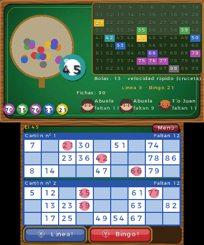 | 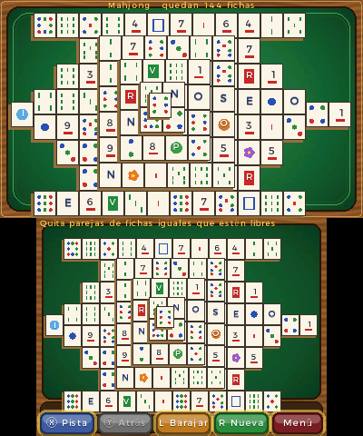 | 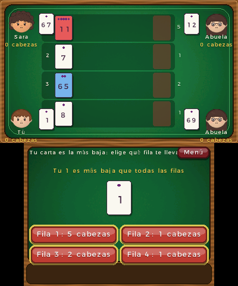 | 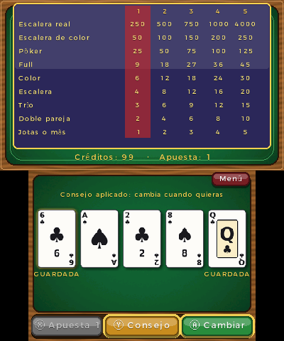 |

| Julepe | Truco | Tresillo | Butifarra |
|:---:|:---:|:---:|:---:|
| 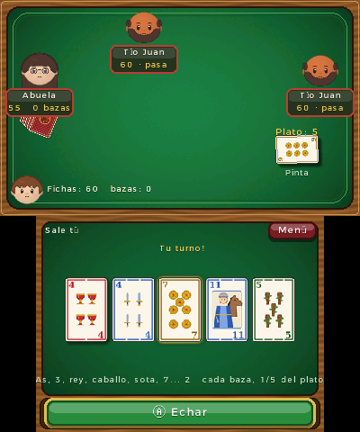 | 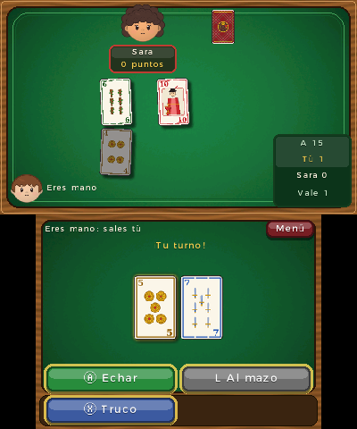 | 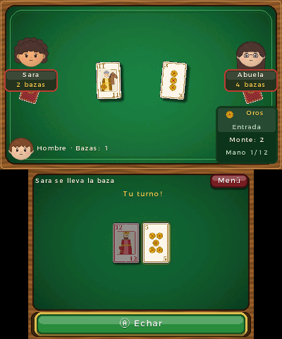 | 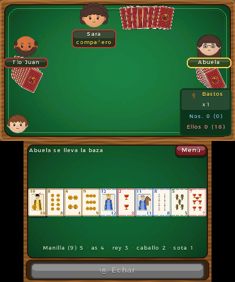 |

| Pumba | Burro | As, 2, 3 | Uno |
|:---:|:---:|:---:|:---:|
| 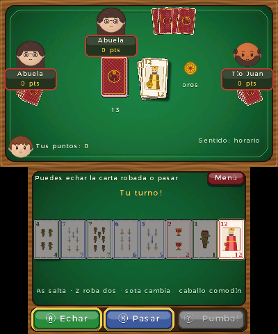 | 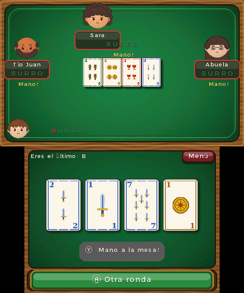 | 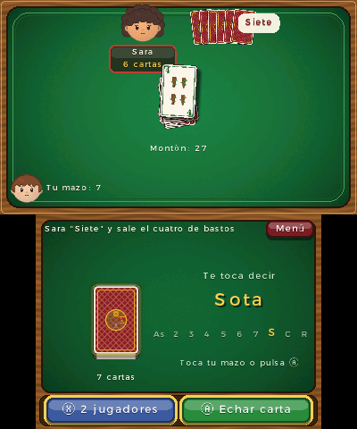 | 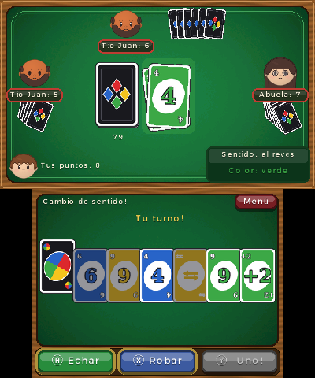 |

| Reversi | La oca |
|:---:|:---:|
| 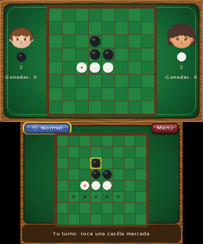 | 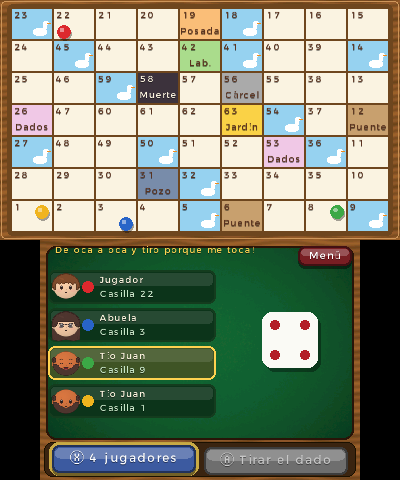 |
